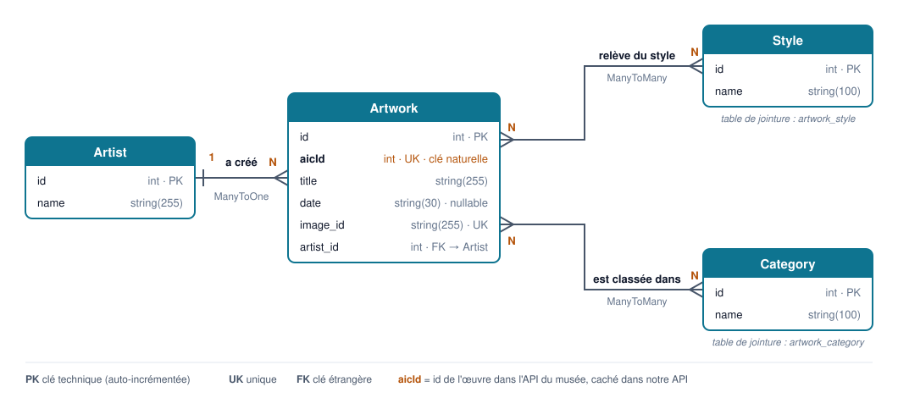

# chicago-api

API REST sur les œuvres de l'**Art Institute of Chicago**, construite avec **Symfony 8.1**, **API Platform 5** et **SQLite**.
Une commande d'import alimente la base depuis l'API publique du musée, sans créer de doublon.

Projet du cours *Architecture de données, API, plateforme* (IIM, A3) par Eva Bouala et Clara Marchal.

---

## 1. Installation et lancement, de zéro

**Prérequis :** PHP 8.4 ou plus (extensions `pdo_sqlite`, `sqlite3`, `intl`, `ctype`, `iconv`), Composer et Git.
Pas de Docker, pas de serveur de base de données : SQLite tient dans le fichier `var/data.db`.

```bash
# 1. Récupérer le projet
git clone https://github.com/EvaBouala/chicago-api.git
cd chicago-api

# 2. Installer les dépendances
composer install

# 3. Créer la base (le fichier var/data.db est créé tout seul) et les tables
php bin/console doctrine:migrations:migrate -n

# 4. Remplir la base depuis l'API de l'Art Institute of Chicago
php bin/console app:import-artworks monet

# 5. Lancer le serveur
php -S 127.0.0.1:8000 -t public
```

Ouvrir ensuite **http://127.0.0.1:8000/api** : Swagger UI liste toutes les routes et permet de les tester.
Le contrat OpenAPI brut est sur `/api/docs.jsonopenapi`.

> Si la Symfony CLI est installée, on peut aussi utiliser `symfony console ...` à la place de `php bin/console ...`
> et `symfony serve -d` à la place de `php -S`.
> Le `.env` versionné ne contient que des valeurs par défaut (aucun secret) : la base pointe sur `var/data.db`.

---

## 2. Le modèle



| Relation | Type | Se lit | Côté propriétaire |
|---|---|---|---|
| Artist → Artwork | **ManyToOne** (1-N) | un artiste a créé plusieurs œuvres, une œuvre a un seul artiste | `Artwork::$artist` (colonne `artist_id`) |
| Artwork ↔ Style | **ManyToMany** (N-N) | une œuvre a plusieurs styles, un style regroupe plusieurs œuvres | `Artwork::$styles` (table `artwork_style`) |
| Artwork ↔ Category | **ManyToMany** (N-N) | une œuvre a plusieurs catégories, une catégorie regroupe plusieurs œuvres | `Artwork::$categories` (table `artwork_category`) |

**Clés :** chaque table a une clé technique `id` (auto-incrémentée). La clé naturelle est `Artwork.aicId`, l'identifiant de l'œuvre dans l'API du musée. Elle est **unique** et sert à ne jamais importer deux fois la même œuvre. `image_id` est également unique.
Les artistes, styles et catégories n'ont pas d'identifiant fourni par la source : ils sont retrouvés par leur nom pendant l'import.

**Ressources exposées :** `/api/artworks`, `/api/artists`, `/api/styles`, `/api/categories` (GET liste, GET un, POST, PATCH, DELETE).

**Groupes de sérialisation :**
- chaque ressource a un groupe de lecture `xxx:lire` et un groupe d'écriture `xxx:ecrire` ;
- une œuvre **embarque** son artiste, ses styles et ses catégories (leur `name` est dans le groupe `artwork:lire`) ;
- un artiste, un style ou une catégorie liste ses œuvres en **IRI**, pour ne jamais embarquer dans les deux sens ;
- `aicId` n'a **aucun groupe** : il est caché dans l'API et n'est jamais écrit par le client, seulement par l'import.

**Validation :** par exemple, `POST /api/artworks` avec `{"title": ""}` renvoie une **422** (`title` est `NotBlank` et `image_id` est obligatoire).

---

## 3. L'import

**Source :** API publique de l'Art Institute of Chicago, sans clé d'API.
`GET https://api.artic.edu/api/v1/artworks/search?q=<sujet>&limit=50&fields=id,title,artist_title,date_display,image_id,style_titles,classification_titles`

> L'API refuse (403) toute requête sans en-tête `AIC-User-Agent` : la commande l'envoie.

**Commande :** `src/Command/ImportArtworksCommand.php`

```bash
php bin/console app:import-artworks <sujet>     # ex. monet, textile, cat, water
```

Exemple :
```
php bin/console app:import-artworks monet
 [OK] 50 importée(s), 0 ignorée(s) car incomplète(s), 0 ignorée(s) car déjà en base.
php bin/console app:import-artworks monet
 [OK] 0 importée(s), 0 ignorée(s) car incomplète(s), 50 ignorée(s) car déjà en base.
```

### Mapping (champ source → base → API)

| # | Champ source | Exemple | Entité.propriété | Type | Nullable | Unique | Contraintes | Lecture | Écriture | Statut |
|---|---|---|---|---|---|---|---|---|---|---|
| 1 | `id` | `111628` | `Artwork.aicId` | integer | oui* | oui | aucune (jamais écrit par l'API) | caché | aucun | Mappé (clé naturelle) |
| 2 | `title` | `"Les Invalides du Sentiment…"` | `Artwork.title` | string(255) | non | non | NotBlank, Length(max: 255) | `artwork:lire` | `artwork:ecrire` | Mappé |
| 3 | `date_display` | `"1853"` | `Artwork.date` | string(30) | oui | non | NotBlank(allowNull), Length(max: 30) | `artwork:lire` | `artwork:ecrire` | Mappé |
| 4 | `artist_title` | `"Paul Gavarni"` | `Artist.name`, lié par `Artwork.artist` | string(255) | non | non | NotBlank, Length(max: 255) | `artist:lire`, `artwork:lire` | `artist:ecrire` | Relation |
| 5 | `style_titles` | `["jouy-en-Josas", "Post-Impressionism"]` | `Style.name`, liés par `Artwork.styles` | string(100) | non | non | NotBlank, Length(max: 100) | `style:lire`, `artwork:lire` | `style:ecrire` | Relation |
| 6 | `classification_titles` | `["textile", "furnishing textile"]` | `Category.name`, liés par `Artwork.categories` | string(100) | non | non | NotBlank, Length(max: 100) | `category:lire`, `artwork:lire` | `category:ecrire` | Relation |
| 7 | `image_id` | `"799cb2f5-ff2a-…"` | `Artwork.image_id` | string(255) | non | oui | NotBlank, Length(max: 255) | `artwork:lire` | `artwork:ecrire` | Mappé |
| 8 | `_score` | `0.0000233` | – | – | – | – | – | – | – | Non importé |

\* `aicId` est nullable en base uniquement pour qu'une œuvre créée à la main par `POST /api/artworks` (qui n'a pas d'identifiant du musée) reste possible. Toutes les œuvres importées en ont un.

`_score` n'est pas importé : l'API l'ajoute pour mesurer à quel point l'œuvre correspond au mot cherché. Il change d'une recherche à l'autre et n'a aucun sens en base.

### Règles de transformation

| # | Règle | Pourquoi |
|---|---|---|
| R1 | Sans titre, l'œuvre est ignorée. Sans `image_id`, elle est ignorée aussi | inutilisable, et `title` / `image_id` sont obligatoires en base |
| R2 | Si l'`id` source (`aicId`) est déjà en base, ou déjà vu dans le même import, l'œuvre est ignorée | relancer l'import ne doit rien dupliquer |
| R3 | Artiste absent ou vide → `"inconnu"`. L'artiste est ensuite retrouvé par son nom, sinon créé | une œuvre a toujours un artiste, et un artiste = une seule ligne |
| R4 | Styles : `trim`, minuscules, sans vide ni doublon, retrouvés ou créés. Liste vide → `["inconnu"]` | « Post-Impressionism » et « post-impressionism » sont le même style |
| R5 | Catégories : même traitement que R4, liste vide → `["inconnu"]` | même raison |
| R6 | Date `"n.d."` (non datée) ou vide → `null`, sinon tronquée à 30 caractères | « n.d. » n'est pas une date |
| R7 | Titre tronqué à 255 caractères, noms de style et de catégorie à 100 | longueur des colonnes |
| R8 | Les artistes, styles et catégories créés pendant l'import sont gardés en mémoire | avant le `flush`, une entité créée n'est pas encore trouvable en base : sans cette mémoire, deux œuvres du même artiste créeraient deux artistes |
| R9 | 50 œuvres maximum par lancement, tout est écrit en une seule fois à la fin (un seul `flush`) | volume raisonnable, un seul aller-retour vers la base |

Chaque règle est commentée dans le code (`T-règle 1`, `T-règle 2`…).

---

## 4. Pagination et filtres

La liste des œuvres (`GET /api/artworks`) est **paginée par 10** et **filtrable**. Les filtres sont déclarés sur l'entité `Artwork` avec des `QueryParameter` d'API Platform.
Les recherches sont partielles et ne tiennent pas compte de la casse. La réponse contient `totalItems` et un bloc `view` (first, next, last).

| URL à tester | Résultat |
|---|---|
| `/api/artworks?page=2` | la 2e page (œuvres 11 à 20) |
| `/api/artworks?titre=water` | les œuvres dont le titre contient « water » |
| `/api/artworks?artiste=monet` | les œuvres dont le nom de l'artiste contient « monet » |
| `/api/artworks?style=impression` | les œuvres dont un style contient « impression » |
| `/api/artworks?categorie=paint` | les œuvres dont une catégorie contient « paint » |
| `/api/artworks?tri=asc` (ou `desc`) | tri alphabétique par titre |
| `/api/artworks?artiste=monet&titre=water&tri=desc&page=1` | les filtres se combinent entre eux et avec la pagination |

Pas d'endpoint `/stats` (bonus non réalisé).

---

## 5. Utilisation de l'IA

**Outil :** Claude (Claude Code, dans VS Code).

**Fait avec Claude :**
- **L'ETL (la commande d'import `app:import-artworks`) :** écrit avec Claude à partir de nos règles de transformation.
- **Débogage :**
  - l'import ne marchait plus parce que l'API du musée renvoie maintenant 403 sans en-tête `AIC-User-Agent` ;
  - le schéma de la base n'était plus synchronisé avec les entités : il manquait la migration de l'index unique sur `image_id` ;
  - un clone neuf du projet ne démarrait pas parce que le `.env` n'était pas versionné ;
  - Windows (Smart App Control) bloquait la Symfony CLI : on est passées à `php bin/console`.
- **Compléter ce qui manquait :** aligner la commande d'import sur notre feuille de mapping (artiste, style et catégorie « inconnu », date « n.d. » → `null`, `aicId` caché dans l'API) et vérifier l'import (deux lancements, zéro doublon).
- **Git :** démêler nos branches, où des commits existaient en double après une erreur de branche, et remettre `feat/eva` et `master` d'aplomb.
- **Explications :** relire l'état du projet par rapport à la grille de notation, expliquer les écarts entre la feuille et le code, et nous expliquer le fonctionnement de `NotBlank(allowNull: true)`, des index uniques ou des migrations SQLite.

Tout le code produit ou modifié par l'IA a été relu, testé et compris par nous deux.

*(c'est pas pour rien que j'ai payé Claude)*
